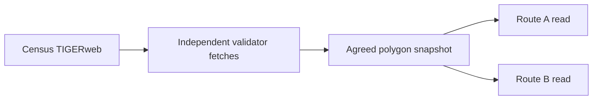

# BoundaryTrace

BoundaryTrace gives other contracts exact route-crossing positions against a reusable boundary snapshot. The first supported region is Colorado, sourced from U.S. Census TIGERweb.

[Contract source](contracts/boundary_trace.py) · [Captured Census GeoJSON](fixtures/colorado.geojson) · [Direct tests](tests/direct/test_boundary_trace.py)

## Observe once, trace many routes



| Method | Behavior |
| --- | --- |
| `observe()` | Independently fetch and normalize the public polygon. Persist it under its SHA-256 digest and return the ID. |
| `get_snapshot(snapshot_id)` | Read the normalized rings, source, and coordinate scale. |
| `trace(snapshot_id, route_json)` | Use a stored boundary to return exact intervals and boundary contacts for two to six route points. |

The leader and each validator independently fetch the complete GeoJSON and check the feature identity. Normalization fixes the coordinate grid, ring direction, start vertex, and hole ordering. Consensus requires exact equality of every normalized vertex. A changed boundary can produce a different snapshot and different route results. Equivalent observations return the existing ID.

## Exact route output

Supply UTF-8 JSON containing integer longitude and latitude pairs in units of 1/100,000 degree. Each segment runs linearly in this grid. The contract intersects the segment against every ring edge using rational arithmetic. It classifies each open interval as `INSIDE`, `OUTSIDE`, or `BOUNDARY`, and returns exact boundary-contact parameters, including an isolated tangent.

Each parameter is a reduced `[numerator, denominator]` pair between 0 at the start and 1 at the end of its segment. The computed results apply to the 2025 1:20,000,000 generalized polygon and the stated coordinate grid. [Census TIGERweb layer](https://tigerweb.geo.census.gov/arcgis/rest/services/Generalized_ACS2025/State_County/MapServer/9)

## Verify locally

```sh
python -m pip install -r requirements-dev.txt
genvm-lint download --version v0.2.16
genvm-lint check contracts/boundary_trace.py
python -m pytest tests/direct -q
```

Direct tests check the two exact crossings in the captured Census response, collinear edge travel, tangent contact, holes, and changed-geometry disagreement.
